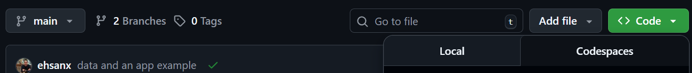
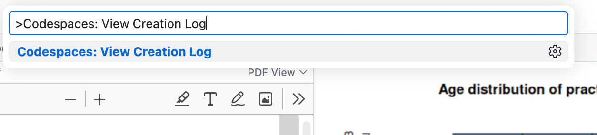

# Opening Your First Codespace

This process is like walking into the library and turning on a computer. Start from your forked repository, then create a fresh, temporary environment in the cloud.

## Steps

1.  Click the green **Code** button

    -   This button is usually for downloading files, but we are using it to launch a computer.

    

2.  Click the **Codespaces** tab

    -   **Crucial Choice:** You will see two tabs: "Local" and "Codespaces."
    -   **Local:** Means downloading to your own messy laptop (Hard mode).
    -   **Codespaces:** Means using the pre-installed cloud computer (Easy mode). Always choose this.

    

3.  Click **Create Codespace on main**

    -   This tells GitHub to build a new computer for you from scratch.

    

<!-- AI-EDIT(2026-10-21): the Codespace now starts from a prebuilt course image (HDSx-workspace .devcontainer/) — wait time, trust box and ready check replace the 2–3 minute build and the TOOLCHAIN SELF-TEST callout, whose output no longer appears on screen (setup finishes before the editor opens); screenshots from a fresh Codespace on 2026-10-21 — needs review -->
## The "Boot Up" Phase

**Wait about 5 minutes the first time.**

-   **What is happening?** GitHub is downloading a computer that already has R, Python, Quarto, and all the course libraries installed. Nothing is installed while you wait.
-   **The Analogy:** Think of this as the "ventilation system" starting up in a lab. It takes a moment to get the environment ready.

While it starts, the bottom-left corner says **Opening Remote…**.

## Trust the Folder

When **VS Code** appears in your browser window, a box asks: **Do you trust the authors of the files in this folder?** These are the course files, so click **Trust Folder & Continue**.

If you clicked **Cancel** or closed the box, VS Code stays in **Restricted Mode**: a grey banner sits at the top and the course tools stay switched off.

To fix it, click **Manage** in that banner, then click **Trust**.

## Is It Ready?

VS Code keeps loading its tools for a few seconds after it appears. Watch the **bottom bar**:

-   **Not ready yet:** a spinning message, such as **Activating Extensions…** or **Refreshing … environments**.

    

-   **Ready:** the spinning message is gone and **Quarto** shows a version number.

    

**Success:** Your Codespace is ready. When you open a `.qmd` file later, a **Run Cell** link appears above each R code chunk.

::: {.callout-note title="If it never gets ready"}
If the bottom bar still has not shown **Quarto** after a couple of minutes:

- Open the Command Palette (`F1`) and run **Codespaces: View Creation Log**. Send the log to the instructor.
- Do not try to install software yourself. Rebuild the environment instead --- see [Troubleshooting: Rebuild Container](workflows09-troubleshooting.qmd) --- and ask for help if it still fails.

:::

<!-- AI-EDIT(2026-09-01): optional course screencast (YouTube ID: A7LDoku1CrA) — HTML-only so the PDF/DOCX build is unaffected -->
::: {.content-visible when-format="html"}
## Video walkthrough (optional) {.unnumbered}


:::
