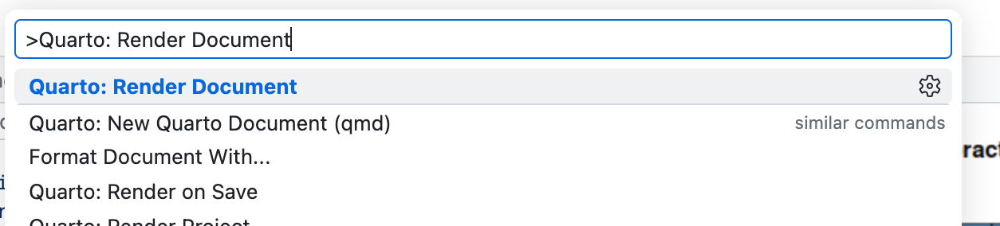
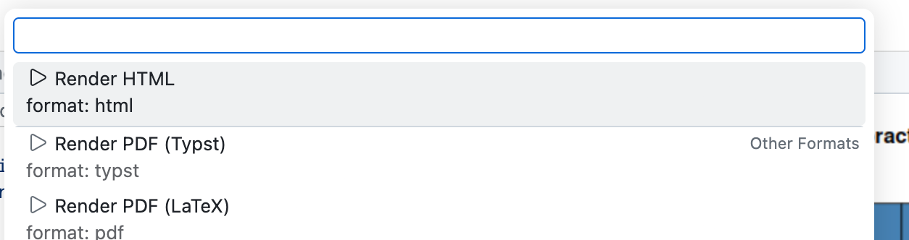
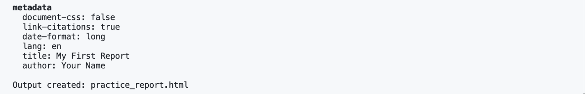
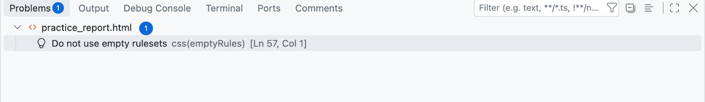
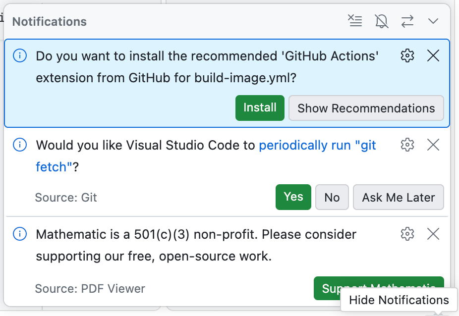

# The Magic Moment: Render Quarto

## Why do we "Render"?

In the old days, you would run code, copy a graph, save it as a JPG, and paste it into Word. If the data changed, you had to redo every step manually.

**The Better Way:** Think of your code (`.qmd` file) as a **Recipe** and the final report (HTML/PDF) as the **Meal**. \* **Editing:** You don't change the meal; you change the recipe. \* **Rendering:** This is the "cooking" process. When you click **Render**, the computer follows your instructions from scratch to create a fresh meal.

This is the secret to reproducibility: if you give your recipe to a friend, they can cook the exact same meal.

## Step 1 — Open the file

1.  Go to the **Explorer** pane (Left side).
2.  Locate and click on the file:

```         
practice_report.qmd
```

This will open the "Source Code" in the center Editor window. You will see a mix of normal text and code chunks.

## Step 2 — Edit name (The YAML Header)

Look at the very top of the file. You will see a block of text sandwiched between three dashes (`---`). This is called the **YAML Header**. It controls the document's metadata.

Find the line that says `author:`

```         
author: "Your Name"
```

**Task:** Delete "Your Name" and type your actual name inside the quotes. Do not remove the quotes!

<!-- AI-EDIT(2026-10-21): course image Codespace — new Step 3 (Run Cell), click-to-view Step 5 and the optional PDF section replace the preview pane, which stays blank in the browser Codespace; screenshots from a fresh Codespace on 2026-10-21 — needs review -->
## Step 3 — Run a code chunk

Before you render the whole report, you can try one chunk at a time. A **Run Cell** link sits above each grey R code chunk.


Click **Run Cell** above the first chunk. The first time, R starts in the terminal at the bottom, prints `[sess] Connected to VS Code`, and then runs your code.


Click **Run Cell** above the chart chunk. The plot opens in an **R Plot** tab next to your file.


## Step 4 — Render

<!-- AI-EDIT(2026-06-11): D-003/TF-010/MIT-019/MIT-020/GAP-R678-1 — Command Palette default + terminal fallback + output location; replaces button-only instructions — needs review -->






After you start the render, **observe the Terminal (Bottom):** you will see text scrolling quickly. This is your code chunks executing. When it prints **Output created: practice_report.html**, your report is ready.



## Step 5 — Look at your report

<!-- AI-EDIT(2026-06-22): REVIEW-row47 / WI-012,TF-010 — corrected output location: student starter project has no output-dir, so practice_report.html lands beside the .qmd (NOT docs/). The docs/ folder is book-repo-only. Matches /_snippets/render-how.qmd. -->
The rendered file, `practice_report.html`, is saved **right next to the `.qmd` file** in the Explorer panel. Click it: it opens in a tab inside VS Code, showing a beautiful, formatted report with your name on it.


::: {.callout-tip title="After you render again"}
The tab does not update by itself. Close it and click `practice_report.html` again to see your changes. To open the report in your own browser instead, right-click the file and choose **Download**.
:::

**Congratulations!** You just performed "Knowledge Translation"—turning raw code into a human-readable document.

## Want a PDF? (optional)

Run **Quarto: Render Document** again and choose **Render PDF (Typst)**. Typst comes with Quarto, is fast, and keeps characters such as Greek letters and emoji that the LaTeX option can silently drop.


Click `practice_report.pdf` in the Explorer. It opens in a PDF tab.


## If it fails (Troubleshooting)

Rendering involves many moving parts, so it sometimes gets stuck.

<!-- AI-EDIT(2026-10-21): course image Codespace — two harmless notices students meet while rendering, kept as they are on purpose — needs review -->
::: {.callout-note title="These are not errors"}
-   **"Problems 1" and a yellow file name** while your `.html` is open: VS Code is checking the page styling that Quarto wrote. Your report is fine, and the note goes away when you close the tab.

    

-   **Notifications under the bell** in the bottom-right corner: a suggested extension, a question about "git fetch", or a note asking you to support the PDF viewer's makers. You do not need any of them, and you never need to pay anything. Close each one with its **×**.

    
:::

-   **The "Wait" Rule:** If nothing happens for 20 seconds, the background process might be initializing. Give it a moment.
-   **The "Retry" Rule:** Sometimes the connection hiccups. Run **Quarto: Render Document** one more time.
-   **The "No Button" Rule:** The Render button sometimes does not appear in a fresh or stale Codespace. You do not need it — the Command Palette and terminal methods above always work. <!-- AI-EDIT(2026-06-11): D-003/GAP-R678-1 — missing-button fallback — needs review -->
-   **The "PDF" Rule:** For a PDF, choose **Render PDF (Typst)**. Everything a PDF needs is already installed, so do not install anything. <!-- AI-EDIT(2026-10-21): replaces the "TeX Warning" rule: TinyTeX now comes with the Codespace, and Typst is the course's PDF route — needs review -->
-   **The "Red Text" Rule:** Look at the **Terminal** tab at the bottom. If you see red text, it is an error message. Read it—it usually tells you exactly what went wrong (e.g., "File not found" or "Syntax error").

Still stuck after trying these rules? See [Troubleshooting: Rebuild Container](workflows09-troubleshooting.qmd) for the step-by-step fix with screenshots. <!-- AI-EDIT(2026-06-11): GAP-MBH-3 — needs review -->

<!-- AI-EDIT(2026-09-01): optional course screencast (YouTube ID: XILaoaswLdI) — HTML-only so the PDF/DOCX build is unaffected -->
::: {.content-visible when-format="html"}
## Video walkthrough (optional) {.unnumbered}


:::
